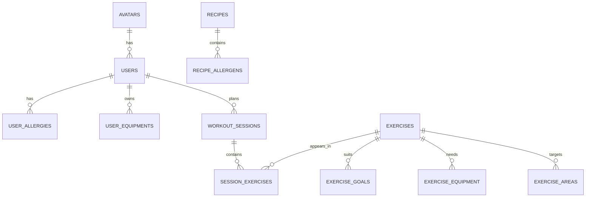

# FitnessAI

A free, budget-friendly fitness and nutrition companion that helps people feel calm and good about their bodies, not stressed about numbers.

This is a portfolio project: I am building it step by step as a real product, using it to practise ML engineering and MLOps (databases, tests, safe rules first, models later). It is not medical advice. Version 1 is for adults (18+) only.

## What works today

- **Safe recipes:** recipes are filtered by the user's diet and allergies.
- **Safe exercises:** exercises are filtered by the user's fitness level, goal and equipment.
- **Plan generator:** the user picks a body area (legs, chest, back, shoulders, arms or core) and a time. The app builds a session of up to 5 exercises that fits the time. If too few exercises match the user's goal, it adds general exercises and says so clearly.
- **Missed-workout logic:** a reminder on the day, a friendly nudge after 1 day, a shorter session after the threshold (2 days by default, a setting), then a suggestion to adjust the plan.
- **101 automated tests** pass.

## Safety comes first

Rules decide what is allowed. A model (later) can only rank choices inside what the rules allow.

- A recipe with an allergen the user has is never shown.
- An exercise that is too hard, or needs equipment the user does not own, is never shown.
- An unknown user gets nothing. The app fails closed.
- The fallback to general exercises only relaxes the goal. It never relaxes level or equipment.
- The user chooses freely. The app guides and never blocks.

## How it works

```
user + chosen area + minutes
        |
        v
safe_exercises (level, goal, equipment rules in SQL)
        |  too few? top up with general-goal exercises, same safety rules
        v
build_session (fit the minutes, up to 5 exercises, clear message)
```

## Data model



The full schema is in `schema.sql` (PostgreSQL, 12 tables with CHECK constraints).

## How to run it

Requires Python and PostgreSQL. Commands below are for Windows PowerShell.

1. Clone the repo and create a virtual environment:
   ```
   py -m venv .venv
   .venv\Scripts\Activate.ps1
   py -m pip install -r requirements.txt
   ```
2. Copy `.env.example` to `.env` and fill in the five `DB_` values. Never commit `.env`.
3. Create two databases: `fitnessai` and `fitnessai_test`.
4. Load the schema and sample data into `fitnessai`, in this order:
   ```
   psql -U postgres -d fitnessai -f schema.sql
   psql -U postgres -d fitnessai -f seed.sql
   psql -U postgres -d fitnessai -f seed2.sql
   psql -U postgres -d fitnessai -f seed_exercises.sql
   psql -U postgres -d fitnessai -f seed3.sql
   psql -U postgres -d fitnessai -f seed_areas.sql
   psql -U postgres -d fitnessai -f seed_exercises2.sql
   psql -U postgres -d fitnessai -f seed_exercises3.sql
   psql -U postgres -d fitnessai -f seed_exercises4.sql
   psql -U postgres -d fitnessai -f seed4.sql
   ```
5. Run the tests: `py -m pytest`

## How it is tested

- Tests use a separate database, `fitnessai_test`, so a failing test can never touch real data.
- A pytest fixture wipes that database and rebuilds it from `schema.sql` and the seed files before every test.
- The fixture refuses to run if the database name does not end in `_test`.
- Most tests check rules (for example: "every returned exercise needs only equipment the user owns") instead of copying long lists of names, so they keep working as the data grows.

## Known limitations

- The sample data is small (4 recipes, 70 exercises) and was tagged by me. A fitness professional has not reviewed it.
- Allergen matching is exact text. A recipe with no allergen rows counts as safe, so it relies on complete labelling.
- Leftover minutes can be lost to rounding when a session is shortened.
- "One reminder per missed session" needs stored state. It is not built yet.
- Generated sessions are not saved to the database yet.

## Roadmap

- FastAPI endpoints (get a plan, log a workout)
- A "full body" day type
- Compare a ranking model against a random baseline, with real numbers
- GitHub Actions to run the tests on every push
- Deployment with a free hosted PostgreSQL